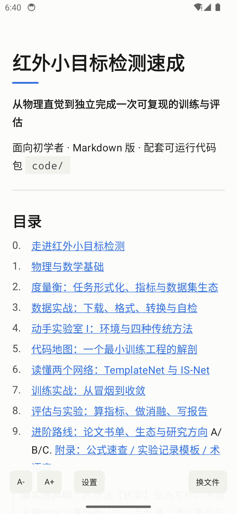

# 墨读 ModuRead · 轻量级 Android Markdown 阅读器

一个只做「读」的 Markdown 阅读器：打开本地 `.md`，专注排版，冷启动直达。

[](https://github.com/Black2716/ModuRead/actions/workflows/android.yml)

| 项 | 值 |
|---|---|
| 应用名 | **墨读** |
| 包名 | `com.yg.moduread` |
| 技术栈 | Kotlin + Jetpack Compose（Material 3） |
| minSdk / targetSdk / compileSdk | 24 / 34 / 34 |
| 解析内核 | commonmark-java 0.22.0 + GFM Tables |
| release APK 实测体积 | **1.18 MB**（1,241,667 字节；R8 + 资源压缩，含公式/目录/搜索/高亮） |
| debug APK 实测体积 | 7.8 MB（不裁剪，仅用于调试） |
| 冷启动（Pixel 后端 API 34 模拟器，host GPU） | **302–505 ms**（`Displayed` 打点） |
| 9.2 万字文档打开到首屏可读 | 约 3.4 s（含 `uiautomator` 轮询开销） |
| 单测 | **51/51**（9 解析 + 8 公式 + 7 目录 + 6 最近文件 + 6 外部打开 + 7 搜索 + 8 高亮） |

## 一、界面截图

| 深色模式 | 表格 + 图片 |
|---|---|
|  |  |

| 首启空态 | 浅色长文 |
|---|---|
|  |  |


分式、上下标、求最值的上下限、定界符、根号、重音、希腊字母与关系符均为原生排版，不走 WebView。

截图位于 [`docs/`](docs/)，用仓库相对路径引用（``），无需外部图床。

## 二、工程目录结构

```
ModuReader/
├── settings.gradle.kts
├── build.gradle.kts                    # AGP 8.5.2 / Kotlin 1.9.24
├── gradle.properties
├── gradlew / gradlew.bat
├── gradle/wrapper/
│   ├── gradle-wrapper.jar
│   └── gradle-wrapper.properties        # Gradle 8.7
├── local.properties                     # sdk.dir 指向本机 SDK（不入库）
├── docs/                                # 真机/模拟器实测截图
│   ├── 01-dark.png                      # 深色模式
│   ├── 02-table-image.png               # 表格 + 图片
│   ├── 03-empty.png                     # 首启空态
│   ├── 04-book-light.png                # 浅色模式长文
│   ├── 05-math.png                      # LaTeX 公式渲染
│   ├── manual-1-git-bash.md             # Git Bash 终端操作手册
│   └── manual-2-sidebar-git.md          # 侧边栏 Git 操作手册
├── sample/
│   ├── sample.md                        # 9.2 万字真实长文（验收用）
│   ├── demo.md                          # 全元素覆盖的最小样例
│   ├── math.md                          # 公式语法回归样例
│   └── pic.png                          # 配合 demo.md 的本地图片
└── app/
    ├── build.gradle.kts
    ├── proguard-rules.pro               # R8 保留 Compose CompositionLocal
    └── src/
        ├── main/
        │   ├── AndroidManifest.xml
        │   ├── res/
        │   │   ├── values/strings.xml          # app_name = 墨读
        │   │   ├── values/themes.xml           # 启动窗口底色（浅）
        │   │   ├── values-night/themes.xml     # 启动窗口底色（深）
        │   │   ├── drawable/ic_launcher_*.xml  # 自适应图标
        │   │   ├── mipmap-anydpi-v26/          # Android 8+ 自适应图标
        │   │   └── mipmap-{m,h,xh,xxh,xxxh}dpi/ic_launcher.png
        │   └── java/com/yg/moduread/
        │       ├── MainActivity.kt             # 单 Activity，无导航框架
        │       ├── md/
        │       │   ├── MdModel.kt              # 只读 AST：MdBlock / MdInline
        │       │   ├── MdParser.kt             # commonmark -> AST 一次性转换
        │       │   ├── MdToc.kt                # 目录抽取 + GitHub slug
        │       │   ├── SearchIndex.kt          # 全文搜索索引（偏移表 + 二分）
        │       │   └── CodeHighlighter.kt      # 4 种语言的轻量词法高亮
        │       ├── data/
        │       │   ├── DocRepository.kt        # SAF Uri -> UTF-8 -> AST
        │       │   ├── ExternalOpen.kt         # VIEW intent 解析（可单测）
        │       │   ├── RecentFiles.kt          # 最近 8 本，无数据库
        │       │   └── MdImageResolver.kt      # 相对路径图片定位（本地）
        │       └── ui/
        │           ├── Theme.kt                # 浅/深双主题 + 系统栏反色
        │           ├── ReaderState.kt          # DocumentState / ReaderPrefs
        │           ├── ReaderViewModel.kt      # 状态 + 偏好持久化
        │           ├── ReaderRoot.kt           # SAF 选择器 + 页面装配
        │           ├── ReaderScreen.kt         # LazyColumn 阅读主界面
        │           ├── MdRenderer.kt           # 块级渲染器（全部元素）
        │           ├── TocSheet.kt             # 目录抽屉（ModalBottomSheet）
        │           ├── SearchSheet.kt          # 搜索面板（命中列表 + 跳转）
        │           └── SettingsSheet.kt        # 字号 / 外观面板
        └── test/java/com/yg/moduread/
            ├── MdParserTest.kt                 # 9 个解析单测（含真实长文）
            ├── LatexTest.kt                    # 8 个公式单测
            ├── MdTocTest.kt                    # 7 个目录单测（含书稿 11 锚点真值）
            ├── RecentFilesTest.kt              # 6 个最近文件单测
            └── ExternalOpenTest.kt             # 6 个外部打开判据单测
```

## 三、渲染支持

| Markdown 元素 | 状态 | 渲染方式 |
|---|---|---|
| ATX / Setext 标题（1–6 级） | 支持 | 字号按级别缩放，加粗，段前留白分级 |
| 段落 | 支持 | 行高 1.75，中文长文排版 |
| 有序列表 | 支持 | 按 `start` 递增编号，支持紧凑模式 |
| 无序列表 | 支持 | `•` 项目符号，支持多层嵌套 |
| 引用块 | 支持 | 左侧主题色竖线 + 缩进，支持嵌套引用 |
| 代码块（fenced / indented） | 支持 | 等宽字体、卡片底色、语言标签、横向滚动、可选中复制 |
| 表格（GFM） | 支持 | 表头加粗、列对齐、按内容加权分配列宽；> 4 列时横向滚动 |
| 链接 | 支持 | 主题色下划线，点击调系统浏览器（页内 `#锚点` 静默） |
| 图片 | 支持 | 块级等比铺满 + 图注；解析相对路径 / `file://` / `content://` |
| 行内代码 / 粗体 / 斜体 | 支持 | `AnnotatedString` 拼装 |
| 分隔线 | 支持 | 1dp 细线 |
| **全文搜索** | 支持 | 命中列表带块号与上下文片段，点击跳转；大小写不敏感，单字查询被拒 |
| **代码高亮** | 支持 | 手写 tokenizer：kotlin/python/bash/json；未知语言原样输出 |
| **外部打开** | 支持 | 文件管理器「用墨读打开」；只声明 `text/markdown`，不抢 `.txt` |
| **最近文件** | 支持 | 空态页列最近 8 本，可单独移除；纯 SharedPreferences，无数据库 |
| **目录抽屉** | 支持 | 按级别缩进，点击直接跳转；书稿 86 个标题 |
| **文档内锚点** | 支持 | `[文本](#slug)` 按 GitHub slug 规则解析后跳转 |
| **阅读进度记忆** | 支持 | 按文档分别记住滚动位置，杀进程重开回到原处 |
| **文档内锚点** `[文本](#slug)` | 支持 | 按 GitHub slug 规则解析后跳转 |
| **阅读进度记忆** | 支持 | 按文档分别记住滚动位置，杀进程重开回到原处 |
| **块级公式** `$$…$$` | 支持 | 原生排版：分式（自适应分数线）、上下标、求和/求积/最值的上下限、定界符、根号、重音、箭头 |
| **行内公式** `$…$` | 支持 | 能线性化的转 Unicode 融入正文（σ、μₜ、x²）；含分式等结构降级为等宽原文 |
| HTML 块 / 行内 HTML | 部分 | 按纯文本显示（不执行 HTML，无 WebView） |
| 任务列表 / 脚注 / 删除线 | 未启用 | 按普通文本渲染 |

## 四、编译与安装

环境：JDK 17、Android SDK（platform 34 + build-tools 34.0.0）、Gradle 8.7（wrapper 自动下载）。

```bash
git clone https://github.com/Black2716/ModuRead.git
cd ModuRead
```

仓库不含 `local.properties`（里面有本机 SDK 的绝对路径），克隆后需要自己生成一份，或直接设置环境变量 `ANDROID_HOME`。

```bash
# 1. 指向本机 SDK
echo "sdk.dir=/path/to/Android/Sdk" > local.properties

# 2. 编译（任选）
./gradlew :app:assembleDebug      # 调试包 app/build/outputs/apk/debug/app-debug.apk
./gradlew :app:assembleRelease    # 正式包 app/build/outputs/apk/release/app-release.apk（已用 debug 证书签名，可直接装）

# 3. 安装
./gradlew :app:installDebug
# 或
adb install -r app/build/outputs/apk/release/app-release.apk

# 4. 跑解析单测
./gradlew :app:testDebugUnitTest
```

Windows 用 `gradlew.bat`；本地无 Gradle 时 wrapper 会自行下载 8.7。

## 五、验收步骤（已在模拟器实测通过）

```bash
adb push sample/sample.md /sdcard/Download/
adb push sample/demo.md   /sdcard/Download/
adb push sample/pic.png   /sdcard/Download/
```

1. 启动应用，首屏为空态：「墨读 / 打开一个本地 .md 文件开始阅读 / 选择文件」。
2. 点「选择文件」→ 系统 SAF → 选择 `sample.md`，顶部大标题 + 正文同步出现。
3. 按元素检查（`demo.md` 覆盖全部元素）：标题、段落、嵌套有序/无序列表、引用块（含嵌套引用）、代码块（语言标签 `python`、横向滚动）、4 列表格、图片、链接、分隔线。
4. 点底部 `A-` / `A+`：字号 13–26sp 逐级变化，正文立即重排，不重新解析。
5. 「设置」→ 滑杆调字号；「外观」切换 跟随系统 / 浅色 / 深色，立即生效且状态栏图标反色。
6. 杀进程重开：自动续读上次文件（SAF 持久化授权）；重装后首次启动为空态。
7. 若文档含本地图片，首次打开会申请 `READ_MEDIA_IMAGES`（Android 13+）/ 存储权限；拒绝时图片降级为占位条，正文不受影响。

## 六、包体与依赖（实测）

| 依赖 | 作用 | release 内实际占用 |
|---|---|---|
| `androidx.compose`（BOM 2024.06.00：ui / foundation / material3） | 全部 UI | classes.dex 主体 |
| `androidx.core:core-ktx:1.13.1` | 兼容层与 WindowInsets | 同上 |
| `androidx.activity:activity-compose:1.9.0` | Activity + SAF 结果回调 | 同上 |
| `androidx.lifecycle:lifecycle-{runtime,viewmodel}-compose:2.8.2` | 生命周期与状态收集 | 同上 |
| `org.commonmark:commonmark:0.22.0` | Markdown 解析 | 约 82 KB（dex 内 org.commonmark 全部类） |
| `org.commonmark:commonmark-ext-gfm-tables:0.22.0` | GFM 表格 | 合并在上述统计中 |
| 自研 `Latex.kt` + `MathView.kt` | LaTeX 子集解析与排版 | 约 60 KB（无第三方公式库，不引入 KaTeX/MathJax/WebView） |
| `junit:junit:4.13.2` | 单测（不打进包） | 0 |

未引入：图片加载库（Coil/Glide，省 0.6–1.2 MB）、导航库、DI 框架、WebView、Splash 库、公式渲染库（KaTeX/MathJax 走 WebView 会让包体涨 2 MB+ 并引入 JS 引擎）。

实测产物：

```
app-debug.apk     7.79 MB   （不混淆，仅调试用）
app-release.apk   1.18 MB   （R8 + shrinkResources；公式 +14 KB，目录/进度 +60 KB，最近文件/外部打开 +3 KB，搜索 +37 KB，代码高亮 +63 KB）
```

## 七、性能设计

- **解析只做一次**：文件读入即转成不可变 AST 并缓存在 ViewModel，主题/字号切换只触发重组。
- **首帧不等 IO**：续读上次文件放在首帧后的 `LaunchedEffect`，冷启动路径上没有任何磁盘读取与解析。
- **懒加载布局**：`LazyColumn` + 40 块分组，9.2 万字文档也只测量可见分组。
- **图片按需解码**：`produceState` + `BitmapFactory`，在 IO 线程解码，离开屏幕即释放。
- **启动无白屏**：`values/themes.xml` 与 Compose 主题同底色，Android 12+ 自适应图标 + `enableEdgeToEdge`。
- 实测冷启动 `Displayed` 打点 302 ms / 505 ms（同环境系统「设置」为 737 ms / 12 s 级）。

> 说明：模拟器首次冷启动会受到 dexopt/JIT 影响；真机上应更低。

## 八、边界与明确不做

- 不做 Markdown 编辑、账号登录、云同步、在线内容抓取。
- 不做网络图片：`http(s)` 图片显示占位提示（保持零网络权限）。
- HTML 不执行，避免引入 WebView 的体积与安全面。
- release 使用 debug 证书签名以便直接安装；上架时替换为自有签名配置即可。
