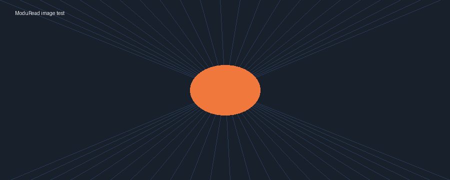

# 渲染自检 demo

这一行包含 **粗体**、*斜体*、`行内代码` 与 [外部链接](https://developer.android.com)。

## 二级标题

- 无序项 A
- 无序项 B
  - 嵌套项 B1
  - 嵌套项 B2
- 无序项 C

1. 有序项一
2. 有序项二
3. 有序项三

### 三级标题

> 引用第一段：所有有效手段本质上在做同一件事——放大目标、抑制背景。
>
> > 嵌套引用：contrast and background suppression。

```python
import torch

def nms(boxes, scores, thr=0.5):
    return torch.ops.torchvision.nms(boxes, scores, thr)
```

| 方法 | 年份 | 指标 | 备注 |
|:--|:-:|--:|:--|
| MPCM | 2016 | 0.82 | 传统对比度 |
| DNANet | 2022 | 0.91 | U 形网络 |
| ISNet | 2022 | 0.93 | 编解码 + 注意力 |



---

结尾段落，用于验证长文滚动与选择复制。
